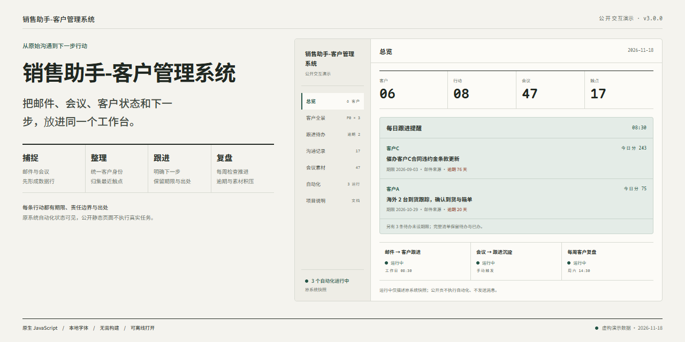

# 客户承诺管理工作台

**Customer Commitment Ledger** — 把邮件与会议里的承诺，变成可追踪、可提醒、可复盘的行动。

这是一个从 Astribot 销售工作流中抽象而来的客户承诺管理系统公开预览。项目以“承诺”为最小管理单元，将客户、行动、会议和邮件触点组织在同一套业务闭环中。

公开版是一个**可直接打开的交互式单文件工作台**：无需登录、无需安装依赖、无需构建，也不连接任何真实业务数据底座。

[在线预览](https://zhoujinq.github.io/customer-commitment-ledger/) · [仓库地址](https://github.com/zhoujinq/customer-commitment-ledger) · [问题反馈](https://github.com/zhoujinq/customer-commitment-ledger/issues)



---

## 目录

- [在线预览](#在线预览)
- [为什么做这个项目](#为什么做这个项目)
- [核心业务闭环](#核心业务闭环)
- [工作台功能](#工作台功能)
- [当前演示快照](#当前演示快照)
- [自动化设计](#自动化设计)
- [数据结构](#数据结构)
- [本地运行](#本地运行)
- [技术实现](#技术实现)
- [项目结构](#项目结构)
- [数据与隐私边界](#数据与隐私边界)
- [维护与更新](#维护与更新)
- [后续路线](#后续路线)
- [字体许可](#字体许可)

## 在线预览

访问：

**https://zhoujinq.github.io/customer-commitment-ledger/**

也可以直接打开以下深链接：

- [客户全景](https://zhoujinq.github.io/customer-commitment-ledger/#customers)
- [承诺追踪](https://zhoujinq.github.io/customer-commitment-ledger/#actions)
- [触点流水](https://zhoujinq.github.io/customer-commitment-ledger/#touchpoints)
- [会议素材](https://zhoujinq.github.io/customer-commitment-ledger/#meetings)
- [自动化说明](https://zhoujinq.github.io/customer-commitment-ledger/#automation)
- [交接文档](https://zhoujinq.github.io/customer-commitment-ledger/#handover)

> 在线页面与仓库中的 `index.html` 是同一套静态代码。页面展示的是固定日期的假名演示快照，不会读取真实客户数据，也不会发送消息或执行自动化任务。

## 为什么做这个项目

销售团队对客户的承诺往往散落在邮件、会议转写、聊天记录和个人待办中：

- 答应了什么，没有统一记录；
- 什么时候到期，缺少持续追踪；
- 为什么做出承诺，找不到原始出处；
- 哪些事项已经逾期，往往在客户追问后才被发现；
- 每周复盘时，难以还原承诺兑现与素材积压的全貌。

本系统把这些碎片整理为可管理的数据行：**谁答应了谁什么、什么时候到期、当前状态如何、原话在哪里。**

一句话概括：

> **邮件和会议进来，行动和提醒出去。**

## 核心业务闭环

| 环节 | 要解决的问题 | 系统做法 |
| --- | --- | --- |
| 01 捕捉 | 原始素材散落 | 新邮件形成触点记录，会议转写形成会议记录 |
| 02 提炼 | 承诺难以结构化 | 从素材中整理行动，保留期限、承诺方和出处原话 |
| 03 追踪 | 到期与逾期缺少提醒 | 按今日分排序，每天聚焦最要紧的承诺 |
| 04 复盘 | 兑现与积压不可见 | 每周汇总承诺变动、逾期、积压和兑现情况 |

### 三条无人值守硬规则

1. **机器只写机器字段**：今日分、最后触点日、触点和会议行可以由自动化写入；卡点、优先级、阶段和客户归属只能由人确认。
2. **不自动确认待裁决项**：自动抽取结果必须经人工确认，不能把模型草案直接当作事实。
3. **失败即停，重试不超过 2 次**：避免无人值守任务无限重试、刷屏或放大异常。

## 工作台功能

工作台包含七个完整视图，可通过左侧导航或 URL hash 切换。

| 视图 | 主要内容 | 交互能力 |
| --- | --- | --- |
| 总览 | 系统快照、关键指标、业务闭环和重点承诺 | 查看核心数据，跳转到承诺追踪或系统说明 |
| 客户全景 | 6 家假名客户的优先级、阶段、触点、承诺与卡点 | 展开客户档案，查看关联会议、触点和承诺 |
| 承诺追踪 | 8 条行动及其期限、状态、今日分和出处 | 按待办、逾期、无期限、已办筛选，展开出处原话 |
| 触点流水 | 17 条邮件触点及客户归属状态 | 查看归属率、未归属数量和触发明细 |
| 会议素材 | 47 场会议的日期、归属与提炼状态 | 搜索会议标题或客户，查看会议量分布 |
| 自动化 | A2、A3、A4 三个核心自动化配置 | 查看触发方式、处理逻辑、硬规则和已知缺口 |
| 交接文档 | 系统原理、数据结构、维护手册与路线图 | 目录定位、阅读完整说明、下载 Markdown |

### 阅读与显示设置

点击页面右下角的 **“显示设置”**，可以调整：

- 强调色；
- 纸色；
- 行密度；
- 今日分刻度显示。

页面同时提供跳到主要内容的链接、语义化控件、当前视图标识，以及适配窄屏的导航和表格滚动。

## 当前演示快照

数据日期：**2026-11-18**。

| 指标 | 数量 | 说明 |
| --- | ---: | --- |
| 客户 | 6 | 客户A–F，全部为假名身份 |
| 行动 / 承诺 | 8 | 2 条逾期、3 条无期限待办、3 条已办 |
| 会议 | 47 | 38 场未归属，主提炼阶段尚未建设 |
| 邮件触点 | 17 | 7 条已归属、10 条未归属 |
| 数据表 | 4 | 客户、行动、会议、触点 |
| 业务视图 | 8 | 今天、风险雷达、客户全景及 5 个异常视图 |
| 核心自动化配置 | 3 | A2 邮件触点、A3 每日推送、A4 周复盘 |

这些数字用于呈现系统的真实业务结构与管理口径；身份、联系方式、单号和外部资源标识均不公开。

## 自动化设计

> 本仓库展示自动化的产品设计与静态配置，不包含真实定时任务、消息发送能力或生产环境脚本。

| 配置 | 触发方式 | 处理逻辑 | 输出 |
| --- | --- | --- | --- |
| A2 新邮件触点落表 | 收到新邮件 | 依次按关键人邮箱、邮箱域名匹配；无法识别则进入未归属；以来源 ID 幂等 | 触点记录、最后触点日 |
| A3 每日承诺推送 | 每天 08:30 | 计算今日分，按逾期与真实约定排序；同一客户在 Top 2 中最多占一条 | 每日最要紧的两条承诺及健康指标 |
| A4 周复盘 | 每周六 14:30 | 只读聚合本周承诺变动、逾期 Top 3、素材积压和兑现情况 | 每周复盘摘要 |

### 今日分

公开快照采用的排序口径为：

```text
今日分 = 逾期天数 × 3 + 真实约定加权 15
```

今日分用于确定提醒优先级，不替代人工判断，也不表示客户价值或承诺重要性的完整评价。

## 数据结构

### 四张核心表

| 数据表 | 关键字段 | 作用 |
| --- | --- | --- |
| 客户 | 客户名、别名、优先级、阶段、卡点、关键人、最后触点日、邮箱域名、归属 | 承诺与触点的归集对象 |
| 行动 | 内容、客户、状态、期限、期限性质、来源、承诺方、阻塞项、出处、今日分 | 承诺的最小管理单元 |
| 会议 | 标题、会议标识、日期、客户、链接、提炼状态、摘要 | 承诺提炼的上游素材 |
| 触点 | 主题、客户、日期、来源、来源 ID、备注 | 证明客户近期往来的轻量流水 |

### 八个业务视图

- 今天：待办且今日分非空，按今日分降序；
- 风险雷达：待办且期限早于今天，按期限升序；
- 客户全景：按 P0 → P2 分组；
- 异常·卡点为空；
- 异常·已废无原因；
- 异常·期限缺失；
- 异常·会议未归属；
- 异常·触点未归属。

## 本地运行

### 方式一：直接打开

1. 下载或克隆仓库：

   ```bash
   git clone https://github.com/zhoujinq/customer-commitment-ledger.git
   ```

2. 进入项目目录，使用浏览器打开 `index.html`。

不需要执行 `npm install`，也不需要构建工具、账号或 API Key。字体和业务代码均在本地，直接打开即可离线浏览。

### 方式二：本地静态服务器

如果希望通过 HTTP 访问，可在项目目录执行：

```bash
python -m http.server 8000
```

然后访问 `http://localhost:8000/`。

### GitHub Pages

本项目适合直接使用 GitHub Pages 发布仓库根目录：

1. 打开仓库的 **Settings → Pages**；
2. 选择从分支部署；
3. 选择主分支与 `/(root)`；
4. 保存后访问本 README 顶部的在线预览地址。

## 技术实现

- **单文件应用**：页面结构、样式、React 运行代码、业务数据和交接文档均包含在 `index.html` 中；
- **无构建依赖**：不需要 Node.js、包管理器或编译步骤；
- **本地字体**：九个 WOFF2 字体文件随仓库提供，不依赖外部字体 CDN；
- **数据入口集中**：演示快照位于 `window.CRM_DATA`，交接文档位于 `window.HANDOVER_MD`；
- **可分享导航**：七个视图支持 URL hash 深链接，以及浏览器前进、后退；
- **响应式布局**：桌面侧栏与移动横向导航并存，宽表格在窄屏容器内滚动；
- **离线可用**：页面没有真实数据请求，也没有外部服务依赖；
- **可编辑介绍卡片**：`assets/project-card.html` 是卡片源文件，`assets/project-card.png` 是 README 使用的同尺寸导出图。

## 项目结构

```text
customer-commitment-ledger/
├── index.html                 # 交互式工作台主文件
├── README.md                  # 项目说明
└── assets/
    ├── project-card.html      # 1280×640 项目介绍卡片源文件
    ├── project-card.png       # 项目介绍卡片导出图
    └── fonts/
        ├── noto-sans-sc-*.woff2
        ├── noto-serif-sc-*.woff2
        ├── ibm-plex-mono-*.woff2
        └── LICENSE-*.txt      # 字体许可证
```

## 数据与隐私边界

公开仓库遵循以下边界：

- 客户仅使用客户A–F等假名，联系人也使用代号；
- 不包含内部人员姓名、内部邮箱、手机号、真实客户名或真实客户别名；
- 不包含真实飞书链接、数据底座链接、资源 token、物流单号或 SN 码；
- Astribot、T1、S1 等公开产品线信息可以保留；
- 数量、日期、逾期天数等快照口径可以保留，但不能据此反推出真实身份；
- 页面不连接真实数据底座，不发送消息，不运行真实自动化；
- 真实系统与公开预览分叉维护，不进行自动同步。

**请勿通过 Issue、Pull Request、提交记录或附件向仓库补充任何真实业务数据。**

## 维护与更新

从真实系统更新公开快照时，建议按以下顺序操作：

1. 从真实系统导出最新快照；
2. 在公开仓库之外完成身份假名化与资源标识清理；
3. 替换 `index.html` 中的 `window.CRM_DATA`；
4. 如需更新交接说明，同步替换 `window.HANDOVER_MD`；
5. 检查客户、行动、会议和触点数量是否一致；
6. 扫描真实客户名、内部人名、邮箱、手机号、单号、token 和飞书链接；
7. 检查所有本地字体与资源引用；
8. 在浏览器验证七个视图、搜索筛选、详情展开、文档下载和移动布局；
9. 确认公开仓库、提交说明、README 和介绍卡片均不含敏感信息后再发布。

新增文案时，如果希望继续保持完全一致的字体表现，应同时检查字体子集的字符覆盖；必要时重新生成对应 WOFF2 文件。

## 后续路线

真实系统与公开预览可以共享产品思路，但分别维护。后续建设重点包括：

1. **承诺提炼主阶段**：从会议素材生成行动草案与待裁决卡，人工确认后进入承诺追踪；
2. **聚合与公式能力**：补充兑现率、沉默天数等指标，并完善降级写入策略；
3. **历史数据回填**：在明确授权后补齐客户历史最后触点日；
4. **异常治理能力**：继续完善期限缺失、未归属、卡点为空和已废无原因等异常视图；
5. **公开演示体验**：在不引入真实业务数据的前提下，持续改进可访问性、交互和说明文档。

## 字体许可

项目使用以下字体，并保留对应许可证：

- Noto Sans SC；
- Noto Serif SC；
- IBM Plex Mono。

上述字体均按 **SIL Open Font License 1.1** 使用，许可证位于 [`assets/fonts/`](assets/fonts/)。
